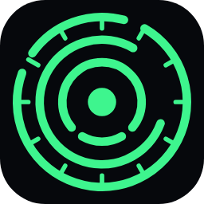
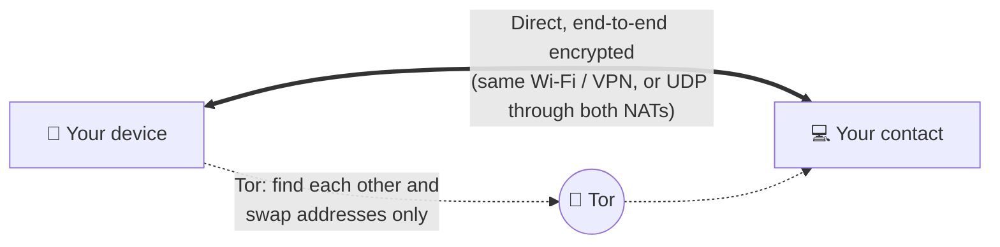

<div align="center">



# SRLTCP

**Private, direct, end-to-end encrypted communication: no servers, no relays, no accounts.**

Chat · Voice & video calls · Files · Folder sharing & sync · Group chats

[](https://github.com/narl3yyy-svg/SRLTCP/releases/latest)
[](https://github.com/narl3yyy-svg/SRLTCP/actions/workflows/macos-dmg.yml)
[](LICENSE)
[](https://www.python.org/downloads/)
[](#security-at-a-glance)

[**Download**](#download) &nbsp;•&nbsp; [**Quick start**](#quick-start) &nbsp;•&nbsp; [**How it works**](#how-it-works) &nbsp;•&nbsp; [**Security**](#security-at-a-glance) &nbsp;•&nbsp; [**Networking guide**](docs/NETWORKING.md) &nbsp;•&nbsp; [**Release notes**](srltcp/RELEASE_NOTES.md)

</div>

<br />

SRLTCP connects your devices **straight to each other**: on the same Wi-Fi or
VPN, across the internet, or over USB serial radios with no network at all.
Only contacts you have added and trusted can reach you. Every session is
end-to-end encrypted with **post-quantum** cryptography, and everything stored
on the device is encrypted too.

<table>
<tr>
<td width="25%" align="center"><b>🔒 Private</b><br /><sub>Only trusted contacts can connect. Nothing goes through anyone's server.</sub></td>
<td width="25%" align="center"><b>⚡ Direct</b><br /><sub>Device to device at full speed, picking the best route by itself.</sub></td>
<td width="25%" align="center"><b>🛡️ Quantum-safe</b><br /><sub>Hybrid X25519 + ML-KEM-768 and Ed25519 + ML-DSA-65 on every session.</sub></td>
<td width="25%" align="center"><b>🧩 Zero setup</b><br /><sub>No accounts, no port forwarding, no router changes.</sub></td>
</tr>
</table>

> [!NOTE]
> **Version 0.17.5.** Search inside any chat, and send files and folders
> right from the message box. Photos stay viewable after a restart, pop-ups
> match the app, and calls show their live latency. Update every device.
> See the [release notes](srltcp/RELEASE_NOTES.md).

## Contents

- [Download](#download)
- [Quick start](#quick-start)
- [How it works](#how-it-works)
- [Features](#features)
- [Security at a glance](#security-at-a-glance)
- [Architecture](#architecture) · [Security model](#security-model) · [Installation](#installation) · [Usage](#usage) · [Development](#development) · [Roadmap](#roadmap)

## Download

Get the latest version from **[GitHub Releases](https://github.com/narl3yyy-svg/SRLTCP/releases/latest)**.

| Platform | Download | Requirements |
|:--|:--|:--|
|  | `SRLTCP-0.17.5-windows-x64-setup.exe` | Windows 10/11, x64 |
|  | `SRLTCP-0.17.5-macos-arm64.dmg` | macOS 12+, Apple silicon (M1 and newer) |
|  | `SRLTCP-0.17.5.apk` | Android 8+ |
|  | `SRLTCP-0.17.5-source.zip` | Python 3.12+ ([from source](#installation)) |

Python and Tor are built into the Windows, macOS and Android apps: nothing else to install.

<details>
<summary><b>First launch: unsigned app warnings</b></summary>

The apps are not code-signed yet, so the first launch shows a warning:

- **Windows:** SmartScreen → **More info → Run anyway**. When Windows Firewall
  asks, allow **Private networks**.
- **macOS:** open the disk image and drag **SRLTCP** to *Applications*. Then
  *System Settings → Privacy & Security* → **Open Anyway**.
- **Android:** allow installing apps from your browser or file manager.

</details>

## Quick start

1. **Install** SRLTCP on both devices (see [Download](#download)).
2. **Pair once.** Tap **Pair** on one device and scan the QR code with the
   other. A link or an NFC tap works too. Both become trusted contacts and are
   verified automatically.
3. **Talk.** Chat, call, send files and share folders, at home or anywhere.
   The devices find each other again by themselves on any network.

## How it works



1. **Same Wi-Fi or VPN:** the devices connect directly.
2. **Different networks** (mobile data ↔ home, two carriers, two homes):
   - The devices meet over **Tor**, used only as a doorbell. Each device has a
     private onion address that only its contacts know.
   - Inside the encrypted session they swap their current addresses.
   - Then they punch a **direct UDP connection** through both NATs, over IPv4
     and IPv6, the way video calls do. This usually takes a few seconds.
3. **No network at all:** USB **serial radio** modems (SiK, LoRa, ESP32).

Messages, files and calls **never** go over Tor. While a contact shows
**CONNECTING**, anything you send waits, then goes out over the direct
connection. No port is ever forwarded or opened on your router, and strangers
on the internet are turned away before anything is read.

➡️ Every setting, common setups and troubleshooting: **[docs/NETWORKING.md](docs/NETWORKING.md)**

## Features

| | |
|:--|:--|
| 🔒 **Post-quantum E2EE** | X25519 + ML-KEM-768 key exchange, Ed25519 + ML-DSA-65 signatures, AES-256-GCM with replay protection, forward secrecy on every session |
| 🛰️ **Direct across networks** | Encrypted UDP hole punching through both NATs (IPv4 and IPv6). Reliable and ordered for chat and files, with separate datagrams for call media. Follows a phone to a new network |
| 🧅 **Tor as the doorbell** | Find trusted contacts on any network without a server; built into the Android and desktop apps |
| 📡 **Serial radios** | Chat, files and voice with no network: private contact beacons and a reliable link built for lossy half-duplex radios |
| 📞 **Voice & video calls** | WebRTC inside the encrypted session, with no third-party servers; voice even works over a serial radio |
| 📁 **Files, folders & sync** | Fast, resumable streaming (zstd, verified SHA-256), E2EE folder sharing, and two-way folder sync with conflict copies and a 30-day trash |
| 🔎 **Search in chats** | Find any word in a conversation, highlighted, with a match count; on the device only |
| 👥 **Group chats** | Up to 32 members, end-to-end encrypted, each message signed by its author |
| ✅ **Verified contacts** | 60-digit safety numbers; automatic when you pair in person (QR, link or NFC tap) |
| 🕶️ **Private by default** | Contact requests instead of an open inbox; discovery only by hand, on your own networks; disappearing messages, app lock and private notifications |
| 💾 **Encrypted at rest** | Keys, contacts, chats, groups and settings sealed (Android Keystore / Windows DPAPI); encrypted backup and restore |
| 🖥️ **Cross-platform** | Windows and macOS tray apps, Android, and Linux, macOS or Windows from source |

<details>
<summary><b>All features</b></summary>

| Feature | Description |
|---------|-------------|
| **Dual transports** | TCP/IP networking + USB serial (pyserial on a PC, the USB host API on Android) |
| **Serial radios** | Only contacts connect (private beacons, nobody is discovered). Chat and call audio go ahead of file data. The radio comes before the internet when you're not on the same Wi-Fi |
| **Fast file transfer** | Windowed streaming (1 MiB chunks direct, 256 KiB over UDP, 2–24 KiB over a serial radio, sized by its measured speed), zstd, verified while streaming. Shows speed and time left on every path. Survives dropped connections and app restarts. Several files at once, optional photo shrinking |
| **Drag-and-drop send** | Drop files onto a contact |
| **Local web UI** | **HTTPS-only** on localhost (default port **9876**), protected by a private access token |
| **Pairing** | QR code, shareable link, or **NFC tap** (Android): one scan pairs both sides |
| **Offline delivery** | Messages queue while a contact is offline and are delivered on reconnect, with ✓/✓✓ receipts |
| **Works over WireGuard** | Find by IP over the VPN, automatic address updates |
| **Signed LAN discovery** | Only when you press **Announce**. Announces are Ed25519-signed and never sent on mobile data or across the internet |
| **Chat history** | Stored locally and encrypted, pruned by your retention setting; message and chat actions like in Signal |
| **Albums** | Photos and videos sent together show as one grid |
| **Tap to download** | Files above a size you choose wait for a tap |
| **Ping / RTT** | Latency in ms, the same figure on both devices; serial link quality % |
| **System stats** | CPU usage and temperature in the status bar |
| **Desktop apps** | Run in the system tray / menu bar so messages and calls keep coming in; optional start at login |

</details>

## Security at a glance

| | |
|:--|:--|
| **Who can reach you** | Only contacts you have trusted. Anyone else becomes a contact request, at most |
| **What crosses the network** | Only sealed, authenticated packets. Even the local UI is HTTPS with a private token |
| **What servers see** | Nothing you send. Tor relays carry only the sealed setup messages; a STUN server sees your IP address (turn off *Direct internet connections* to avoid it) |
| **Your router** | Never asked to open anything: no port forwarding, no UPnP |
| **On the device** | Identity, contacts, chats and settings are encrypted at rest |
| **Audits** | [SECURITY.md](SECURITY.md) (threat model, reporting) · [docs/SECURITY_AUDIT.md](docs/SECURITY_AUDIT.md) (latest penetration test) |

---

## Architecture

SRLTCP uses a modular package layout inspired by [chatx5](https://github.com/narl3yyy-svg/chatx5):

```
srltcp/
  app.py                    # CLI entry point (web, send, identity, url)
  core/
    identity.py             # Per-transport identities (Ed25519 + ML-DSA-65)
    trusted.py              # Contacts: pinned keys, verification, pair secrets
    verify.py               # Safety numbers
    backup.py               # Encrypted backup / restore
    settings.py             # Settings (encrypted at rest)
    discovery.py            # UDP/TCP peer discovery registry
    node.py                 # Top-level node (messaging + sharing + call ringing)
    protocol/
      framing.py            # Length + CRC32 frames
      messages.py           # Binary message types
      crypto.py             # Hybrid handshake, session keys, AES-GCM, replay window
      pq.py                 # ML-KEM-768 / ML-DSA-65 (cryptography or pure Python)
      signed.py             # Signed payload helpers
    messaging/              # Mixin-composed backend
      backend.py            # Orchestrator
      links.py              # Peer link map
      connect.py            # Handshake + session keys
      announce.py, ping.py  # Discovery broadcasts, RTT / dead-link detection
      pairing.py            # Contact cards (QR / link / NFC), pairing, verification
      store.py              # On-disk chat history
      transfer.py           # Windowed, resumable file transfer
      share_peer.py         # E2EE folder/file shares
      sync.py               # Two-way folder sync with a contact
      groups.py             # Group chats
      paths.py, punch.py    # Tor → direct path switching, hole punching (UDP, IPv6)
      tor.py                # Onion service, Tor dialing (the doorbell)
      turn.py               # On-phone call media forwarder (media through the session)
      disappear.py          # Disappearing messages
  transports/
    tcp.py                  # TCP listener + UDP discovery
    serial.py               # USB serial (pyserial)
  web/                      # Local UI (aiohttp + WebSocket, access token, calls.js)
  routes/                   # REST + share + WS routes
  utils/                    # Vault (encryption at rest), files, network, platform helpers
android/                    # Gradle + Chaquopy Android app (see android/README.md)
desktop/                    # Windows / macOS desktop app (Electron tray app; see desktop/README.md)
tests/                      # pytest suite
scripts/                    # check.sh, build-android.sh, build_desktop.sh, simulate*.py, tor_testnet.sh, pentest/
```

## Security model

### Identity

Each transport (TCP, Serial) has its own **Ed25519 keypair** plus a post-quantum **ML-DSA-65** key (from its own random seed). The node hash ID is the first 32 hex chars of `SHA-256(Ed25519 public key)` — similar to Reticulum-style addressing.

Identities are stored, encrypted, in `~/.srltcp/identities/` (or `%APPDATA%\SRLTCP\identities` on Windows).

### End-to-end encryption

1. **Handshake (quantum-safe)** — fresh X25519 *and* ML-KEM-768 keys every session, signed (with a timestamp) by both identity keys: Ed25519 and ML-DSA-65. Each side checks that the peer's hash ID is derived from the key it presents and that both keys match the ones pinned for that contact, so contacts cannot be impersonated; replayed handshakes are rejected. Breaking one algorithm (with a quantum computer or a new attack) is not enough: the session key needs both secrets.
2. **Session keys** — HKDF-SHA256 from the X25519 and ML-KEM shared secrets (salted with both ephemeral keys and the ML-KEM transcript), separate keys per direction; new keys every session (forward secrecy)
3. **Payloads** — AES-256-GCM with 64-bit counter nonces and a sliding replay window; the message type and flags are authenticated. All chat text, receipts, file offers, call signalling and metadata are encrypted, and unencrypted application messages are rejected
4. **Trust** — only trusted contacts' messages, files and share requests are accepted; anyone else becomes a contact request
5. **File chunks** — Each chunk is encrypted before it leaves your node; it may be zstd-compressed **before** encryption (flag bit). Chunk size (1 MiB direct, 256 KiB over UDP) affects throughput only — not encryption.

### How data is transferred

| Path | What travels on the wire | Encrypted? |
|------|--------------------------|------------|
| **TCP / WAN (port 7825)** | Framed binary protocol after handshake | Yes — payloads are opaque AES-GCM blobs |
| **USB Serial** | Same framed protocol over serial | Yes — identical E2EE session |
| **UDP discovery (7826)** | Signed peer announces (hash, name, endpoints, Ed25519 signature) | Metadata is plaintext on LAN; signatures prevent spoofing |
| **Web UI (9876)** | Browser ↔ local node over HTTPS | Localhost TLS + access token; other local apps can't use the API |
| **Calls** | WebRTC media (DTLS-SRTP) carried inside the SRLTCP session via an on-phone forwarder | Yes — double-encrypted: DTLS-SRTP inside the E2EE session |
| **NFC pairing** | Contact cards (public key, name, LAN address) | Public data; requires phones a few cm apart |

**File transfer flow:** upload to local staging → (queued while the contact is unreachable) → `FILE_OFFER` (encrypted JSON) → `FILE_ACCEPT` → encrypted `FILE_CHUNK` stream, confirmed by `FILE_ACK` (a sliding window: the sender keeps a limited amount unconfirmed and resends from the last confirmed byte after a lost piece, a path change or a re-key) → `FILE_COMPLETE` with the SHA-256, computed while streaming → the receiver, which hashed while writing, answers with a final `FILE_ACK` (verified or not). The receiver writes strictly in order to a hidden partial file (`.name.srltcp-part`, which the gallery and other apps skip) in your incoming folder and gives it its real name only after the SHA-256 check, so nothing half-received or damaged ever shows up; a cancelled or damaged download is deleted. Either side can cancel (`FILE_REJECT`). Files never go over Tor: while the contact is only reachable there, the transfer waits (paused) and both devices set up a direct path, then it resumes by itself.

### Security software alerts (work networks)

SRLTCP only talks to your contacts, plus Tor and STUN to find them — nobody can get into your computer through it (TCP 7825 turns away strangers from the internet before reading anything). Antivirus or company firewalls may still notice that traffic: *"Tor address blocked"* is the Tor doorbell, and an "unknown IP" on UDP 7828 is a contact or STUN server. Since 0.15:

- **Quiet networks** (*Settings → Network → Quiet networks*, or *Make the network I'm on quiet*): on those networks SRLTCP uses no Tor, STUN or direct internet connections at all. Contacts on the same Wi-Fi/VPN still work.
- **No automatic discovery:** devices are found only when you press **Announce** or *Find by IP*.
- **No scanning:** the "birthday punch" (thousands of probes to random ports) was removed.
- **No router port mapping:** SRLTCP never asks a router to open a port (UPnP / NAT-PMP was removed in 0.17.1).
- **Contacts that don't answer** for 2 minutes aren't dialed again until you open their chat, send them something, change networks or restart the app. They can still reach you: their messages and calls come through.

### What is not encrypted

- LAN/UDP discovery announces (names, IPs, ports — signed but not encrypted)
- Connection metadata (who talks to whom, when)
- Received files in your incoming folder (so other apps can open them). Your keys, contacts, chats, groups and settings **are** encrypted on the device: with a hardware-backed Android Keystore key on phones, DPAPI on Windows, an owner-only key file on Linux/macOS
- Self-signed localhost HTTPS certificate (browser trust is manual; the Android and desktop apps pin it)

See [SECURITY.md](SECURITY.md) for vulnerability reporting, the threat model and hardening; the latest penetration test is in [docs/SECURITY_AUDIT.md](docs/SECURITY_AUDIT.md).

### Web UI hardening

- **Access token** — every page/API/WebSocket request needs the per-install token (`~/.srltcp/web_token`); open the link printed at startup or run `srltcp url`
- **HTTPS only** on `127.0.0.1` — auto-generated localhost certificate (RSA 4096-bit on a PC, 2048-bit on Android; the app pins it)
- **TLS 1.2+** with modern cipher suites; no cleartext HTTP
- **Localhost-only binding** — refuses non-loopback Host headers
- **Security headers** — strict CSP (no inline scripts, no third-party requests), HSTS, `X-Frame-Options: DENY`, `no-referrer`
- **Origin validation** on POST requests and WebSocket connections
- **Path traversal protection** on file/share APIs
- **Constant-time** token comparison for share sessions

### First-run setup

On first launch, the web UI shows a setup wizard (or *Restore a backup* when moving from another device). Settings persist, encrypted, in `~/.srltcp/settings.json`:

| Setting | Description |
|---------|-------------|
| Display name | Shown to peers on the network |
| Web port | HTTPS port (default **9876**); restart to apply |
| Keep messages | 1 day … forever, or until restart |
| Incoming files folder | Where received files are saved |
| Shared folder | Default folder for browse/share |
| LAN IP | Pinned interface for discovery & announce |
| Quiet networks | Networks (work, school) where Tor, STUN and direct internet connections are all paused |
| Tor | *Find contacts on other networks (Tor)*, on by default: only to set up direct connections |
| Direct internet connections | Phone-to-phone over UDP (IPv4 and IPv6), on by default |
| Privacy | Disappearing messages, app lock, private notifications, backup / restore |
| Timezone | Region for the status clock (time shown at top of sidebar) |
| Show clock | Toggle live clock in the UI |

Change port from CLI: `./run.sh web --port 9999`

---

## Installation

### Desktop app: Windows 11 (x64) and macOS (Apple silicon)

The easiest way on a computer: download from [Releases](https://github.com/narl3yyy-svg/SRLTCP/releases). Nothing else to install: Python, SRLTCP and Tor are inside.

| | File | Install |
|---|---|---|
| **Windows 10/11, x64** | `SRLTCP-X.Y.Z-windows-x64-setup.exe` | Run it and follow the steps (no admin rights needed; installs for your user). The first time, Windows SmartScreen may say *Windows protected your PC* because the installer isn't code-signed: **More info → Run anyway**. When Windows Firewall asks about *python.exe*, allow **Private networks** (contacts on your Wi-Fi/VPN connect to it). |
| **macOS 12+, Apple silicon (M1 and later)** | `SRLTCP-X.Y.Z-macos-arm64.dmg` | Open the disk image and drag **SRLTCP** into *Applications*. The app isn't notarized by Apple, so the first time macOS says it can't check it: open *System Settings → Privacy & Security*, scroll down and click **Open Anyway** (or in Terminal: `xattr -dr com.apple.quarantine /Applications/SRLTCP.app`). Allow the camera and microphone when you start your first call. |

How it works:

- **One window, one tray icon.** SRLTCP opens in its own window. Closing the window keeps SRLTCP running in the **system tray** (Windows, next to the clock) or the **menu bar** (macOS), so messages and calls still come in; click the icon to open it again. *Quit SRLTCP* in the icon's menu stops it.
- **Start when I sign in** (*Open at Login* on a Mac), in the icon's menu: SRLTCP starts in the background when you log in.
- **Same data as run.bat / run.sh.** The app uses the same data folder (`%APPDATA%\SRLTCP` on Windows, `~/.srltcp` on a Mac): moving from `run.bat` keeps your identity, contacts and chats. Don't run both at once (they'd want the same ports); the app says so if you try.
- **Big files start at once:** a file you pick or drop is sent straight from where it is on your disk (no copy first, as a browser needs). Keep it there until it's sent.
- **Unread messages** show as a badge on the Dock icon (Mac) or a flashing taskbar button (Windows).
- **Log file:** the icon's menu → *Show log file* (no access token is ever written to it).
- **Private and pinned:** the window only shows SRLTCP's own page. It trusts exactly the certificate the SRLTCP process made (its SHA-256), only on 127.0.0.1. Links to other sites open in your browser. Camera, microphone and notifications are allowed for SRLTCP's page only.

Building the apps yourself: [desktop/README.md](desktop/README.md).

### From source: macOS (Apple silicon) and Linux

One launcher, `run.sh`, for both:

```bash
git clone https://github.com/narl3yyy-svg/SRLTCP.git
cd SRLTCP
./run.sh web
# Verbose backend logs:
./run.sh web --debug
```

Requires Python 3.12+. macOS's own `python3` is older: install Python from [python.org](https://www.python.org/downloads/macos/) or with Homebrew (`brew install python@3.12`). On Linux: e.g. `sudo apt install python3.12 python3.12-venv`.

**Tor on the first start.** If Tor isn't installed, `./run.sh web` asks in the terminal whether to download the **Tor Expert Bundle** for this computer from torproject.org (~20 MB, checksum-verified, into `SRLTCP/tor-expert-bundle`): the Apple-silicon (arm64) build on an M-series Mac, x86_64 or arm64 on Linux. Tor is only used to find contacts on other networks; answer **n** to skip (you won't be asked again; `./run.sh tor-setup` downloads it later). Tor you installed yourself (`brew install tor`, `sudo apt install tor`, Tor Browser) is found and used instead, and you're not asked.

**Apple silicon (M1 and later).** `run.sh` runs everything natively as arm64, even from a Terminal opened with Rosetta: it picks a Python that runs as arm64 (python.org's and Homebrew's in `/opt/homebrew` do), rebuilds a `.venv` that an Intel (x86_64) Python made, and downloads the arm64 Tor. An Intel Mac gets the x86_64 builds. There's no separate Mac script: `run.sh` checks which system it's on.

Open the link printed in the terminal — `https://127.0.0.1:9876/?token=…` (self-signed cert — accept once for localhost). The token keeps other programs on your machine out of your chats; run `srltcp url` to print the link again.

Press **Ctrl+C** in the terminal to shut down cleanly.

For USB serial on Linux, add your user to the `dialout` group:

```bash
sudo usermod -aG dialout $USER
# log out and back in
./run.sh web --serial
```

### From source: Windows

```cmd
git clone https://github.com/narl3yyy-svg/SRLTCP.git
cd SRLTCP
run.bat web
```

Requires [Python 3.12+](https://www.python.org/downloads/) with **Add to PATH** checked.

The first time, if Tor isn't installed, `run.bat web` asks whether to download the **Tor Expert Bundle** from torproject.org (~20 MB, checksum-verified, into `SRLTCP\tor-expert-bundle`). Tor is only used to find contacts on other networks; answer **n** to skip (you won't be asked again; `run.bat tor-setup` downloads it later).

### pip install

```bash
pip install -e .
srltcp web
```

### Android (Gradle + Chaquopy)

See [android/README.md](android/README.md). The APK embeds the same `srltcp/` Python code via **Chaquopy** — built **locally** with Gradle (no cloud CI).

**Prerequisites**

| Tool | Notes |
|------|--------|
| **JDK 17+** | Any JDK 17 or newer (tested with 21); set `JAVA_HOME` if `java` is not on PATH |
| **Android SDK API 34** | Platform + build-tools 34.x |
| **Python 3.12** | Used by Chaquopy at build time. If `python3` is another version, set `SRLTCP_BUILD_PYTHON=/usr/bin/python3.12` |
| **adb** | USB debugging enabled on the phone |

```bash
export ANDROID_HOME="$HOME/Android/Sdk"
export PATH="$PATH:$ANDROID_HOME/platform-tools"
```

**Clean rebuild (recommended after Python or Android changes)**

```bash
cd /path/to/SRLTCP
bash scripts/sync-android-python.sh          # copy srltcp/ into the APK tree
cd android
rm -rf app/build .gradle build               # remove old build artifacts
./gradlew clean
./gradlew assembleDebug renameDebugApk        # development build
```

Output: `android/app/build/outputs/apk/debug/SRLTCP-<version>.apk` (one APK for phones, arm64; add `-PsrltcpAbis=arm64-v8a,x86_64` for an emulator or Chromebook)

**Release APK (installs as an update).** Every released APK is signed with the
same SRLTCP release key, so a new version installs over the old one with your
data kept. The key is never in this repository: GitHub Actions signs with it
from the repository's secrets ([Android APK workflow](.github/workflows/android-apk.yml)),
or locally:

```bash
SRLTCP_KEYSTORE=/path/to/srltcp-release.jks SRLTCP_KEYSTORE_PASSWORD='…' bash scripts/build-android.sh
# -> android/app/build/outputs/apk/release/SRLTCP-<version>.apk
```

A debug build (`bash scripts/build-android.sh debug`) is signed with a
throwaway key and can't update a released app.

**Install on a connected device**

```bash
adb uninstall com.srltcp.app                 # optional — fresh install
adb install -r android/app/build/outputs/apk/release/SRLTCP-<version>.apk
adb shell am start -n com.srltcp.app/.MainActivity
```

**Live logs (device attached via USB)**

```bash
adb logcat -c                               # clear old logs
adb logcat -s SRLTCP:* python.stderr:*      # follow SRLTCP + Python output
```

**On the phone:** tap **☰** for contacts, **⚙** for Settings (full-screen). Default folders: `Downloads/SRLTCP/Incoming` and `Downloads/SRLTCP/Shared` (grant storage access when prompted). TCP works over Wi‑Fi, mobile data and VPN; direct UDP/IPv6 (found via the built-in Tor) covers the rest; a USB serial radio (*Settings → Serial*) works with no network at all.

| Symptom | What to do |
|---------|------------|
| `SDK location not found` | Set `ANDROID_HOME` or `android/local.properties` with `sdk.dir=...` |
| Gradle / Java errors | Use JDK 17 or newer |
| White screen | Wait ~30s for Python; check logcat |
| File attach fails | Rebuild with v0.1.52+ (WebView file picker) |
| Can't delete shared folder | Use **Delete** in Settings → Folders (v0.1.52+) |

---

## Usage

### P2P mode (default)

Start the web UI on two machines on the same LAN:

```bash
# Machine A
./run.sh web --name "alice"

# Machine B
./run.sh web --name "bob"
```

1. Click **Pair** on one machine and let the other scan the QR code (or paste the link) — both become trusted contacts
   - Or press **Announce** on both devices and **Trust** the other under *Discovered*
2. Select the contact and chat, send files, or start a voice/video call

### Finding each other (LAN, WireGuard / VPN)

| Network | What to do |
|---------|------------|
| **Same Wi-Fi / LAN** | Press **Announce** on both devices (within 10 minutes of each other). Devices appear under *Discovered*. SRLTCP never announces or scans by itself. |
| **WireGuard / any VPN** | VPNs carry no broadcast: use **Find by IP** with the other device's VPN address (after it pressed Announce). |
| **You know the IP** | *Add Contact → Find a device by IP*, e.g. `10.0.100.5`. |

After that, addresses look after themselves: when a contact's IP changes (new Wi-Fi, mobile data, VPN reconnect) it tells you its new addresses inside the encrypted session (or the two of you meet again over Tor) and the app reconnects; nobody has to press Announce again.

**WireGuard checklist** (only if devices don't find each other):

- Each phone's peer config must route the VPN subnet: `AllowedIPs = 10.0.100.0/24` (not just the server's address).
- The server must forward traffic **between** peers: `net.ipv4.ip_forward=1` and allow `wg0 → wg0` in the firewall (e.g. `iptables -A FORWARD -i wg0 -o wg0 -j ACCEPT`).
- Allow TCP **7825** (connections) between peers, and UDP **7826** if you use Announce. Port 9876 is local-only and never needs opening.
- Test from phone A's browser: `https://10.0.100.5:9876` should show a certificate warning or "SRLTCP is locked" — that proves the phones can reach each other.

### Phones on different mobile carriers / without the VPN

Mobile carriers put phones behind carrier-grade NAT: a phone on mobile data usually has **no IPv4 address another phone can connect to**. SRLTCP still connects them **directly over UDP** in most cases (below): they meet over **Tor** (built in, no setup), swap addresses inside the encrypted session and punch through both NATs, and Tor never carries your messages, files or calls: they wait for the direct connection. There are no relays and no servers in between.

**Direct without port forwarding (UDP).** With *Settings → Network → Direct internet connections* on (default), two phones on different networks (two mobile carriers, mobile data and a home Wi-Fi, two homes) connect straight to each other: each learns its public address from a STUN server, they swap addresses and key shares inside the session they already have over Tor, and both send UDP packets to each other at once, which opens both NATs (hole punching). The connection is encrypted per packet with keys only the two of you have, the signed quantum-safe handshake runs inside it, and it carries chat, files and calls at the full speed of both connections (the header shows **DIRECT**). In our simulation (two carrier NATs, TCP between them blocked, packet loss) the phones were direct after about 10 s. Speed follows BBR (like YouTube/QUIC on mobile), so random radio losses don't slow it down: on an emulated LTE path with a 140 ms round trip and 1 % loss a file moves at about 2.1 of the link's 2.5 MB/s (before 0.12.1: 0.1 MB/s), and chat goes out ahead of file data. "Symmetric" carrier NAT (a new port for every destination) on *both* sides can't be crossed by any direct technique: messages wait until one phone is on Wi-Fi or both have IPv6, and *Check connection* (with its copyable report) says so. SRLTCP never scans: it only sends to addresses a contact gave it, and never asks a router to open a port. Phones on a VPN and the home Wi-Fi also connect directly (LAN/VPN addresses are shared inside the session). This shares your public IP address with your contacts (and the STUN server); turn it off to connect only on the same Wi-Fi or VPN. Details: [docs/NETWORKING.md](docs/NETWORKING.md#direct-connections-across-networks-hole-punching).

**No server, no port forwarding: Tor as the doorbell.** With *Settings → Network → Find contacts on other networks (Tor)* on (default) on both devices, they find each other from any network through the Tor network: phone on mobile data, PC on a VPN, a friend's Wi-Fi. Each device publishes a private onion service; its address goes only to trusted contacts (inside the encrypted connection), and only trusted contacts can connect through it. Tor is **only the doorbell**: over it the two devices swap their current addresses and keys and set up a direct UDP or IPv6 connection (the badge shows CONNECTING, then DIRECT, usually within seconds). Messages, files and calls never go over Tor; they wait and go out at full speed the moment the direct connection is up. Tor is built into the Android app and the desktop apps; from source, `run.bat web` / `./run.sh web` offer to download it the first time (or install [Tor Browser](https://www.torproject.org/download/): SRLTCP starts its own copy of Tor by itself). Tested on a private Tor network (`scripts/tor_testnet.sh` + `scripts/simulate_tor.py`).

Every setting explained, plus common setups and troubleshooting: **[docs/NETWORKING.md](docs/NETWORKING.md)**.

### Pairing

| Method | How |
|--------|-----|
| **QR code** | *Pair* → the other device taps *Scan their QR code* (Android camera: keeps focusing, tap to focus, pinch to zoom, flashlight; or a browser with BarcodeDetector) |
| **Link** | *Pair* → *Copy link* / *Share…*, send it over a channel you trust; the other side pastes it into *Pair* |
| **NFC (Android)** | Open *Pair* on **both** phones and hold them back to back (NFC on, screens unlocked). The phones take turns reading each other and exchange contact cards automatically; you feel a short vibration when it worked |

Pairing is always two-way. With QR, link and NFC both phones add each other: the device that showed the code adds whoever scanned it automatically (the scan carries a one-time secret from that code) and opens the new chat — even if the two only reach each other later, or an app restarts in between. If you add someone from *Discovered* (or with an old code), their phone pops up **Contact request — Add them back?**; tapping *Accept* makes you contacts on both sides.

**Contacts on another network you've never met:** add each other with *Add contact* → the hash ID and the **Tor address** (each copies theirs by tapping the `Tor: …onion` line under their hash ID at the top of the contact list, shown once Tor is connected). Both of you add each other; then you find each other over Tor and connect directly, as if you had paired. Anyone with your Tor address can tell when you're online, so share it like a phone number; *Settings → Network → New Tor address* replaces it.

A pairing code is a signed contact card (hash ID, public keys, name, and every address the device has — VPN first). It works once and expires after 15 minutes.

**Verified contacts.** The shield next to a contact's name shows whether you checked their keys: filled with a tick when verified. Pairing **in person** (QR scan or NFC tap) verifies both phones automatically. For a contact added another way, tap the shield: scan the code on their phone, or compare the 60-digit **safety number** in person or on a call and tap *The numbers match*. The number covers both identity keys, including the post-quantum one, and is the same on both phones. Details in [SECURITY.md](SECURITY.md#verified-contacts).

### Editing contacts

Tap the contact's name at the top of a chat, the **⋮** next to a contact, or long-press it → *Edit contact*. You can rename them (only you see the name), set their LAN/VPN address and port, verify them, block/unblock and delete.

**Check connection** (in *Edit contact*) tries every address the app knows for that contact (and Tor) and says in plain words what works and what to change — e.g. "the VPN must include the home network". It also names what the network itself is doing: a Wi-Fi that keeps devices apart (plane, hotel, café, guest Wi-Fi), both phones behind the same public address (the same Wi-Fi, a satellite link like Starlink, or a carrier), or UDP blocked. It shows whether this device's NAT is *easy* (keeps its port: direct connections work) or *hard* (a new port for every destination), measured again each time you press it, so a router change shows at once; on a home PC behind OPNsense / pfSense it names the router fix ([docs/NETWORKING.md](docs/NETWORKING.md#home-router-opnsense--pfsense)).

**Wi-Fi with a sign-in page** (planes, hotels, cafés): until you sign in, nothing reaches the internet. On Android the app shows a bar at the top, *This Wi-Fi needs you to sign in*, with a button to the Wi-Fi settings (tap the network there to open its sign-in page). It uses what Android already knows about the network; the app sends nothing to find out. SRLTCP doesn't try to get around a network's sign-in or its rules: on a plane, both phones usually can't reach each other directly (the Wi-Fi keeps passengers apart), so messages wait and go out once you're on another network.

**Deleting a contact** keeps your chat with them for 24 hours: add them back within that time and the conversation carries on. After 24 hours it is deleted for good, and adding them again starts fresh. Group chats are not affected.

### Privacy: backup, restore, disappearing messages

*Settings → Privacy*:

- **App lock** (Android, off by default): SRLTCP asks for your fingerprint, face or screen lock when it's opened and after 30 seconds in the background. Messages and calls still arrive while it's locked; a call can be declined from its notification. Turning it on asks you to unlock once, to be sure you can.
- **Hide message content on the lock screen** (Android, off by default): a locked phone shows "SRLTCP — New message", and calls ring without the caller's name (the call screen opens when you unlock or answer); unlocked, notifications show everything.
- **Disappearing messages** (off by default): messages and files you send in one-to-one chats are deleted from both phones 1 hour, 1 day, 1 week or 4 weeks after sending; a small timer shows on those messages. Each person's setting applies to what they send.
- **Backup**: enter a password (8+ characters, a passphrase is better) and tap *Create backup*. Android asks where to save the file (Downloads, a USB stick, Drive…); a PC downloads it. The file holds your identity, contacts, chats, groups and settings, encrypted with that password. Received files, shared folders and paused transfers are not in it.
- **Restore**: on the new device tap *Restore from backup…* (also offered on the first-run screen), pick the file, enter the password. SRLTCP replaces its identity, contacts and chats with the backup's and restarts; your contacts see the same you. Use a restored identity on one device only.

### Calls

Voice and video calls use WebRTC. Offer/answer are sent inside the encrypted SRLTCP session, so DTLS fingerprints are authenticated by the contact's identity key. The media itself also goes through the session: each device runs a tiny media forwarder on localhost (127.0.0.1) for its own browser/WebView, which passes the (already DTLS-SRTP encrypted) packets to the other phone as encrypted `CALL_MEDIA` messages. So **calls work wherever chat works** — same Wi-Fi, WireGuard/VPN or direct UDP/IPv6 — with no STUN/TURN server. Calls never go over Tor: if a contact is only reachable there, the call starts once the direct connection is up (usually a few seconds). **Back to chat during a call:** tap **Chat** in the top-left corner of the call (or use Android's back gesture) and the call shrinks to a small window at the top right (their video, or a pill with the timer for a voice call) while you text, send files or open other chats; drag it anywhere, tap it to bring the call back, or hang up from it. During a video call the camera button switches between the **front and rear camera** (on whichever side answered or called); on Android, **Answer** on the ringing notification answers straight away. **Switching networks mid-call** (Wi-Fi ↔ mobile data) doesn't end the call: it shows *Reconnecting…* and resumes once the session is back (it waits up to 90 s), restarting the WebRTC connection over the new path.

**Earpiece / speaker (Android).** Calls start on the earpiece (voice) or the loudspeaker (video). A wired or Bluetooth headset takes over when connected. The speaker button switches between them. The app applies the route again when the other side's audio starts and when a headset is plugged in or removed, because the WebView's audio engine can reset it on some phones. On Android 12+ it uses `setCommunicationDevice` and falls back to the speakerphone switch if the phone refuses. Speaker volume during a call is the phone's *call* volume: press the volume keys while in the call.

**The other person's picture.** By default a video call shows the contact's whole picture, with black bars when their screen or camera has a different shape than yours (a wide monitor on a phone, a phone on a monitor), so nothing is zoomed in or cut off. The frame button next to the camera button switches to **Fill the screen** (zoomed in, edges cut off) and back; double-tapping the video does the same. The choice is remembered on that device, and *Settings → General → Video calls* sets it too.

**At your ear (Android).** During a call (voice or video), while the call screen is in front, covering the proximity sensor (your ear, a hand) turns the screen off like the phone app: an ear or cheek can't end the call, go home or open the notifications; it comes back when you move the phone away. Phones differ, so the app uses both the system's proximity screen-off and its own reading of the sensor (a black, untouchable screen with the status and navigation bars hidden; in a video call the videos are hidden too, since a phone may draw video above everything else). When the screen comes back, the app restarts the call's sound and applies the earpiece/speaker route again. The speaker button is blue while the loudspeaker is on. As a backup, touches with a large contact area or several points at once press nothing on the call screen.

**Leaving the app during a call (Android).** Swipe home or switch apps and the call goes on: a **video call** shrinks into a small floating window over your other apps (picture-in-picture, like Maps while navigating; tap it to return, or use its hang-up button), and every call shows a **Call in progress** notification with the timer, *tap to return* and **Hang up**. The microphone (and camera, for video) stay on meanwhile; the app tells Android so (a foreground service for the microphone/camera, during calls only). During every call a watchdog checks every 2 s that the sound and picture are still playing and that the microphone and camera still deliver, and restarts whatever stopped (e.g. a camera Android took away while the app was in the background).

**PC camera (Windows).** In the desktop app only Windows' own setting below applies. In a browser, the camera needs allowing twice: allowed for the SRLTCP page (icon at the left of the address bar) and allowed by Windows in *Settings → Privacy & security → Camera* (and *Microphone*), including **Let desktop apps access your camera**, since browsers count as desktop apps. Only one app can use a webcam at a time on Windows: close Teams, Zoom, Skype, the Camera app or another tab using it. Some laptops also have a camera privacy switch or key. If the camera still can't be opened, the call continues with voice and the app shows the reason.

### Group chats

*Groups → New group*, give it a name and tick the trusted contacts to add. Everyone you add gets the group automatically (only invites from your own contacts are accepted).

- Every message is signed by its author and sent over the normal one-to-one encrypted connections — no group server and no shared group key.
- You send to the creator and to the members you have as contacts; the creator passes messages on to the rest. So members who don't know each other still see every message, and the creator can't change or invent anyone's message (each one carries its author's signature).
- Members who are offline get missed messages and member-list changes when they come back.
- The creator renames the group and adds or removes members (tap the group name at the top of the chat). Anyone can *Leave group*; the creator leaving closes it for everyone.
- Text only for now — files and calls stay one-to-one.

### When the VPN is off

Nothing changes: the app moves to direct UDP/IPv6 by itself and back to the VPN when it returns. If no path works at all (for example Tor is off on one side), a message waits on your phone (tap its tick: *Waiting to send*) and goes out by itself a few seconds after a path is back — nothing is lost.

### Running in the background (Android)

SRLTCP keeps running after you close it, like any messenger, so messages, calls and contact requests arrive as notifications. While the app is open, a message from a chat you don't have open shows only as the unread count on that contact or group (no pop-up over the app). To stop it completely, **swipe the SRLTCP notification away** (Android 14 and newer) or tap **Quit** on it (any version — older Android keeps that notification pinned). Opening the app starts it again.

### Running in the background (desktop app)

Closing the window keeps SRLTCP running in the tray / menu bar, so messages and calls still arrive (as notifications). The first time, a notification says so. Quit from the icon's menu (or Cmd+Q on a Mac): SRLTCP closes its connections and ports cleanly before it exits.

### USB Serial P2P

Two devices over a USB-serial cable or a pair of **serial radios** (SiK/3DR
telemetry radios, LoRa or ESP32 serial bridges), no network at all.

- **Android:** plug the adapter into the phone (USB-C OTG), *Settings → Serial*:
  turn it on, same baud rate on both phones, Save. Android asks once to allow
  SRLTCP to use it. Supported: FTDI, CP210x, CH34x, PL2303,
  Arduino/ESP32/RP2040/STM32 boards.
- **Which adapter:** *Automatic* (default) uses the adapter plugged in most
  recently and moves to a new one as soon as it's plugged in. Picking one
  saves it; the trash icon next to the list forgets it (back to Automatic).
- **The radio comes first** when the two phones aren't on the same Wi-Fi/LAN:
  an internet or Tor session moves to the radio as soon as the contact is in
  range (without a gap), and back to the shared Wi-Fi as soon as there is one
  (a network change or the contact appearing on your Wi-Fi triggers it at
  once). A file that was moving carries on over the new path. When one phone
  leaves the radio, the other notices within seconds (its radio check gets
  no answer) and both continue over the internet.
- **PC:** `./run.sh web --serial --serial-port /dev/ttyUSB0` (or `COM3`).
- Contacts are the **same contacts** as over Wi-Fi, and **only contacts**:
  nobody is discovered over the radio. Phones send private *beacons* that
  only the contacts they name can read (no name, ID or key in a beacon; to
  anyone else in range they're random bytes), then connect by themselves
  (the header shows **SERIAL**; that connection's handshake does carry both
  names and keys, see SECURITY.md). A stranger's radio gets no answer, and
  its handshakes are ignored. Chat,
  files and groups work over it, slowly; a file shows its speed and the time
  left, and chat, pings and call setup wait behind one turn of file data at
  most (under a second at 57600 baud). A cancelled file's queued data is
  dropped at once.
- **Plug and go:** plug the second phone's adapter in while the app runs and
  the phones connect by themselves (about 6 s on a cable or SiK radio, ~17 s
  on a LoRa bridge in simulations): after an adapter is plugged in or a radio
  session drops, each phone calls its contacts every ~4 s at random moments
  for 90 s, then every ~30 s.
- **Speed:** 57600 baud is at most ~5.7 KB/s on the line. Packet headers,
  checksums, acknowledgements and taking turns on the air use part of it: in
  simulations of two full apps at 57600 baud a file moves at ~3.45 KB/s over
  a cable, ~2.8 KB/s over SiK telemetry radios and ~0.9 KB/s over a LoRa
  bridge (`scripts/bench_radio.py`, `scripts/bench_link_matrix.py`). Radios
  and phones set to 115200 baud roughly double it, if the radios' air speed
  keeps up. *Settings → Serial*
  shows what the radio carries right now (↑/↓ per second).
- **Voice calls** work over the radio: low-bitrate Opus (~8 kbit/s, 60 ms
  packets, nothing sent in silence), each voice packet one unacknowledged
  radio packet ahead of everything else. A video call becomes a voice call
  (a radio carries a few KB/s). A call that can't connect ends with the
  reason after 90 s instead of staying on *Connecting…*. Calls need a radio
  pair with a few KB/s each way and a baud rate of 57600 or more.
- Both phones always agree: if one side loses the session (restart, a lost
  answer), its next beacon makes the other reconnect too, and a busy radio
  session is never dropped for late pings.
- The link is **reliable over lossy, half-duplex radios**: messages go in
  packets of 50 or 114 bytes (bigger while the link is clean) with a CRC-32,
  several messages per turn, a turn lasting up to 1.5 s (3 s for file data;
  chat cuts in), listening first so the two sides never transmit over each
  other. The receiver acknowledges each turn with the speed it measured;
  the sender paces at that speed, sends only the missing packets again, and
  backs off only when losses pile up at the end of bursts (an overflowing
  radio buffer), not for random noise
  (`srltcp/transports/serial_link.py`). The answering phone shows the
  contact as connected only once the other side proves it has the session.
- *Settings → Serial* shows live stats (sent/received, good/bad packets,
  resends, last heard) and says what's wrong: bad packets only means a baud
  rate mismatch; nothing received means the radios aren't paired (channel,
  net ID, air speed) or the other side is off.

### CLI messaging

```bash
srltcp send --recipient <hash_id> --text "Hello" --host 10.0.0.5
```

### Local REST API

Every API call needs the access token. On Linux/macOS:

```bash
export SRLTCP_TOKEN=$(cat ~/.srltcp/web_token)   # Windows: %APPDATA%\SRLTCP\web_token
```

### File transfer (API)

```bash
# Send a file to a connected peer
curl -k -H "Authorization: Bearer $SRLTCP_TOKEN" -X POST https://127.0.0.1:9876/api/transfer \
  -H 'Content-Type: application/json' \
  -d '{"recipient_hash":"<hash>","path":"/path/to/large.iso"}'

# List transfers
curl -k -H "Authorization: Bearer $SRLTCP_TOKEN" https://127.0.0.1:9876/api/transfers
```

Transfers are **resumable**: after a dropped connection, a path change or a **restart of either app**, the file continues from what the receiver already has on disk (`FILE_RESUME`). Unfinished transfers are kept in `transfers.json` (data folder, owner-only) and come back *paused* until the contact is connected again; the receiver re-checks the part it already has, and a file that was edited or deleted in the meantime is not resumed (both sides show it as failed). With *Keep messages: Until restart* nothing is kept.

Files **wait like messages**: sending to a contact who isn't reachable right now returns a transfer in state `paused` (the chat shows *waiting for connection*). It's offered automatically as soon as a session with that contact comes up. An offer that's never answered (lost when the link dropped) is sent once more after 30 s, then waits for the next connection.

**Preparing to send.** A file you pick in the page is first copied into SRLTCP (a browser doesn't let it read the original). For a big file on a slow computer that takes a while, so the chat shows it right away with *Preparing to send · 37 % · 1.6 of 4.4 GB · 14 MB/s · 3 min left* and a ✕ to cancel; then the transfer itself starts. The **desktop app** skips the copy: it sends the file straight from where it is, so even a 4 GB file starts at once.

In the web UI, pick **several files at once** with the paperclip, or **drag files** from your file manager onto a contact in the sidebar. Progress, speed and a cancel button show in the file's bubble, in that contact's chat only. Images and videos preview in chat during transfer. Click to enlarge in a viewer that zooms with two fingers, a double-tap or the mouse wheel (the rest of the app doesn't zoom; it fits the screen); use **Download file** to save it — you are asked where to save (Android shows the system *Save as* screen; desktop Chrome/Edge show a save dialog, other browsers use their download folder).

**Typing a message:** on a phone or tablet the keyboard's Enter key starts a new line and the blue arrow sends; with a real keyboard (PC, desktop app) Enter sends and **Shift+Enter** starts a new line. Line breaks show in the message on both sides.

Several **photos or videos sent in a row** (within 2 minutes) show as one **album**, a grid you tap to open each one.

**Download automatically up to** (*Settings → General*, default 2 GB; a separate *Over the serial radio* limit, default 2 MB): a received file larger than this waits in the chat with a **Download** button (✕ declines it) and nothing is stored until you tap; the sender sees *waiting for them to tap Download*. Over the API: `POST /api/transfers/{id}/download`.

**Long-press a message** (right-click on a PC), like in Signal: **Copy** (the whole message; on a PC you can also drag over part of it with the mouse), **Save** (files), **Save all** (on a photo or video of a group sent together: every one of them, as the original files, into a folder you pick once — on a PC in Chrome/Edge; other browsers download each to your downloads folder), **Select** (then Copy or Delete several), **Info** (sent/received time, delivery, connection, file) and **Delete** (from this device; a photo, video or file takes the received file with it). **Long-press a chat** in the list for *Delete chat…* (every message of that chat, optionally with the files received in it; your contact keeps theirs). API: `POST /api/messages/delete` with `{"ids": [...], "peer": "<hash>"}` (or `"group"`), `POST /api/chats/delete` with `{"peer": "<hash>"}` or `{"group": "<id>"}` and optional `"delete_files": true`.

**Shrink photos before sending** (*Settings → General*, off by default) sends photos as JPEG with the longest side at most 2560 px: a 12 MP phone photo goes from ~5 MB to ~1 MB, which matters on mobile data. The re-encoded photo carries none of the original's metadata (GPS location, camera, time). Screenshots and PNG graphics, GIFs and anything the device can't decode are always sent as they are.

### Sharing folders and files (E2EE)

Open a chat → **folder icon** in the header (or the contact's **⋮** → *Share folder*). The share window has three tabs:

**Share**
1. *What*: **a folder** (Choose folder; your default shared folder is pre-filled) or **files** (pick one or more; a private copy is shared, so you can move or edit the originals).
2. *With*: tick contacts, or pick a **group** (every member who is your contact gets it). Contacts who aren't connected now get the offer automatically the next time they are.
3. *Name* (optional), *Available for* (5 min … until you stop it), *Downloads per person* (1 … unlimited).
4. *Password* (optional): recipients must type it to open the share. Tell them another way. It's sent only inside the encrypted connection, you keep only a salted hash, and 5 wrong tries lock the share for 10 minutes.

**Shared with me**: tap a share → enter the password if it has one → tap a file to download it (or *Download as ZIP* for a folder). Downloads use the normal encrypted file transfer.

**My shares**: who has what, time left, downloads used, "waiting for them to connect"; **Stop sharing** ends access at once.

Each recipient gets their own grant bound to their identity: nobody else can use it, even with the password. Shares survive restarts; files copied for a share are deleted when it ends.

**API:**

```bash
# Files: upload into a private share folder (repeat -F for more files)
curl -k -H "Authorization: Bearer $SRLTCP_TOKEN" -F file=@photo.jpg https://127.0.0.1:9876/api/share/files
# Share a folder (or the uploaded files: "kind":"files","path":<returned path>)
curl -k -H "Authorization: Bearer $SRLTCP_TOKEN" -X POST https://127.0.0.1:9876/api/share/peer/offer \
  -H 'Content-Type: application/json' \
  -d '{"recipients":["<peer_hash>"],"group_id":"","path":"/home/user/shared","ttl_preset":"1d","download_limit_preset":"unlimited","password":""}'
# Open a share you received (add "password" if it has one)
curl -k -H "Authorization: Bearer $SRLTCP_TOKEN" -X POST https://127.0.0.1:9876/api/share/peer/list \
  -H 'Content-Type: application/json' -d '{"owner_hash":"<owner_hash>","grant_id":"<grant_id>"}'
# Download a file from it
curl -k -H "Authorization: Bearer $SRLTCP_TOKEN" -X POST https://127.0.0.1:9876/api/share/peer/fetch \
  -H 'Content-Type: application/json' \
  -d '{"owner_hash":"<owner_hash>","grant_id":"<grant_id>","path":"docs/readme.txt"}'
```

### Folder sync

Contact's **⋮** → *Sync a folder…* → choose a folder (and the name they see) → *Start syncing*. Your contact gets an invitation and picks where their copy goes (default `Downloads/SRLTCP/Sync/<name>` on Android). From then on, adding, changing or deleting a file on either side is copied to the other whenever you're both connected: on the same Wi-Fi or directly across networks. Each folder is scanned every 20 seconds and right after you reconnect; *Sync now* doesn't wait.

- **Two-way and incremental.** Only changed files travel, through the normal end-to-end encrypted, resumable file transfer, checked against their SHA-256.
- **Conflicts.** If you both change the same file before it syncs, both phones keep the same version under the original name and the other one next to it as `name (conflict <date> <device>).ext`. Nothing is lost.
- **Deletes** are copied too, but on the other side the file goes to the hidden `.srltcp-sync/trash` folder inside the synced folder for 30 days. A delete on one side and an edit on the other keeps the edit.
- **Pause, resume, stop** from the same window. Stopping (on either side) ends it for both; the files stay where they are.
- **Safety.** A contact can only touch the folder of a sync you started or accepted with *that* contact, every path they send is checked (nothing outside the folder, no hidden `.srltcp-sync` files), and a file is only sent if it's exactly the version asked for. Both devices need a version with folder sync.

### Legacy HTTP share sessions (localhost only)

For local tooling, token-based HTTP browse remains available on the **localhost HTTPS** UI only:

```bash
curl -k -H "Authorization: Bearer $SRLTCP_TOKEN" -X POST https://127.0.0.1:9876/api/share/create \
  -H 'Content-Type: application/json' \
  -d '{"path":"/home/user/shared"}'

curl -k -H "Authorization: Bearer $SRLTCP_TOKEN" "https://127.0.0.1:9876/api/share/<session_id>/list?token=<token>"
```

### No port forwarding

SRLTCP never needs a port forwarded, and has no setting for it. TCP 7825
accepts connections only from your own networks (LAN/VPN) and your contacts'
known addresses. Never forward the web UI port (9876): it stays on localhost.

---

## Performance notes

| Setting | Value | Rationale |
|---------|-------|-----------|
| Chunk / window | 1 MiB / 24 MiB direct TCP · 256 KiB / 24 MiB UDP · 8 KiB serial | Keeps each path full without flooding it |
| Tor | Doorbell only: swaps addresses, then the direct path carries everything | One Tor circuit tops out around 0.3 MB/s, far below a direct path |
| Compression | zstd (level 1 direct, 3 on slow paths) | Skipped for photos, videos, archives and data that doesn't shrink |
| Frame CRC | CRC32 | Cheap integrity check per frame |
| Hashing | SHA-256 while streaming, both sides | No extra pass over the file before or after |
| Off the event loop | read/hash/compress/encrypt and write/hash in worker threads | Chat, calls and UI stay responsive during big transfers |
| Memory | Streaming; bounded reorder buffer (48 MiB) | Never loads the full file into RAM |

**Tips for maximum speed:**

- Use wired Ethernet or USB 3 serial adapters at 115200+ baud
- Direct LAN/VPN/IPv6 paths are used automatically whenever they work (no hop in between)

---

## Development

### Desktop / Python

```bash
python -m venv .venv && source .venv/bin/activate
pip install -e ".[dev]"
# Tests use SRLTCP_DATA_DIR automatically — do not run pytest against ~/.srltcp

./run.sh web                    # HTTPS web UI + P2P node (open the ?token= link it prints)
./run.sh tor-setup              # download Tor for this computer (macOS arm64 / Linux / run.bat on Windows)
bash scripts/check.sh           # ruff + mypy + pytest (run before tagging)
pytest tests/ -v
```

| Command | Description |
|---------|-------------|
| `srltcp web` | Web UI + P2P node |
| `srltcp send` | One-shot CLI message |
| `srltcp identity` | Show local hash IDs |
| `srltcp url` | Print the private web UI link (with access token) |
| `python scripts/simulate.py` | Run three local nodes and drive their UIs end-to-end in Chromium (needs `pip install playwright`) |
| `bash scripts/tor_testnet.sh start DIR` + `python scripts/simulate_tor.py` | Two nodes talking only over a private, offline Tor network |
| `sudo bash scripts/simulate_udp.sh` | Two phones behind carrier NATs find each other over a private Tor network and punch a direct UDP connection; file speed; symmetric NAT waits |
| `python scripts/bench_udp_path.py` | Direct UDP speed and chat delay over emulated mobile paths (delay, jitter, deep buffers, loss); no root |
| `python scripts/bench_serial_file.py [KB] [baud] [loss]` | A file between two full nodes over simulated USB serial radios (line speed, USB packets, lost frames): speed and ping |
| `python scripts/pentest/pentest_local.py` | Automated penetration tests (node) |
| `sudo bash scripts/simulate_wireguard.sh` | Two "phones" + a server on a real WireGuard VPN in network namespaces: discovery, messaging, IP change |
| `bash scripts/sync-android-python.sh` | Copy `srltcp/` into Android project before Gradle |
| `bash scripts/build-android.sh` | Full local APK build |
| `bash scripts/build_desktop.sh [win\|mac]` | Desktop apps: Windows x64 installer and macOS Apple-silicon app, plus a `.dmg` when built on a Mac (see [desktop/README.md](desktop/README.md)). GitHub Actions builds the `.dmg` on every push to `main` ([macOS build](.github/workflows/macos-dmg.yml)) |
| `xvfb-run -a node desktop/tests/smoke.js` | Desktop app test: node start, pinned certificate, tray, restart, clean quit |

**Releases:** bump `srltcp/__init__.py` and `android/app/build.gradle.kts`, update `srltcp/RELEASE_NOTES.md`, build the APK and the desktop apps locally, tag `vX.Y.Z`, attach the APK, the Windows installer, the macOS disk image (.dmg) and the source zip to [GitHub Releases](https://github.com/narl3yyy-svg/SRLTCP/releases).

---

## Changelog

Full history: [srltcp/RELEASE_NOTES.md](srltcp/RELEASE_NOTES.md). Click the version badge in the app status bar for in-app release notes.

## Roadmap

**Done (v0.17)**

- [x] Phone on mobile data ↔ computer at home: direct in seconds, whatever Tor's delay (0.17.1)
- [x] Simpler network settings: always the exact ports, no port forwarding or router port mapping at all (0.17.1)
- [x] Android APKs signed with one release key: updates install over the installed app (0.17.2)
- [x] Settings next to the clock on every device (0.17.2)

**Done (v0.14–0.16)**

- [x] Desktop apps: Windows 11 x64 installer and macOS Apple-silicon app, system tray / menu bar, Python and Tor built in (0.16.0)
- [x] Nothing automatic or scan-like on the network: manual discovery, no random-port probing, router port mapping off by default, quiet networks for work and school (0.15.0)
- [x] Security hardening: strangers refused before the handshake, small frames until authenticated, safer file names and folder sync (0.15.0)
- [x] `run.bat` / `run.sh` offer to download Tor (Windows, macOS Apple silicon, Linux); built-in Tor on Android binds reliably (0.14.9–0.15.1)
- [x] Video calls show the whole picture, with a Fit / Fill switch (0.15.1)

**Done (v0.11–0.13)**

- [x] Direct UDP between networks (QUIC-style reliable, encrypted transport in pure Python; STUN + hole punching; BBR; Tor only as the meeting point)
- [x] No relays and no servers at all (0.13.0); group chats over direct links
- [x] USB serial adapters on Android (USB host API), Automatic adapter choice
- [x] Serial radios: reliable link for lossy half-duplex radios, private contact beacons (nobody discovered over the air), radio before the internet
- [x] Voice calls over a serial radio (low-bitrate Opus as unacknowledged radio datagrams); file speed and time left on every path

**Done (v0.10.0)**

- [x] Folder sync with a contact: two-way, incremental, conflict copies, 30-day trash for deletes

**Done (v0.9.0)**

- [x] Quantum-safe sessions: X25519 + ML-KEM-768 key exchange, Ed25519 + ML-DSA-65 signatures
- [x] Direct IPv6 connections set up from a Tor session (no relay or server)
- [x] Verified contacts: safety numbers, automatic when pairing in person
- [x] Encryption at rest (Android Keystore), encrypted backup / restore
- [x] Disappearing messages, app lock, private lock-screen notifications
- [x] Transfers survive restarts; several files at once; optional photo shrinking

**Done (v0.8.0–0.8.3)**

- [x] Transfer engine v2 (windowed, verified while streaming, cancel both ways)
- [x] Calls ring like phone calls (default ringtone, lock screen); ✓✓ for delivered files

**Done (v0.6.0–0.7.0)**

- [x] Direct connections across networks without port forwarding (hole punching)
- [x] Reach contacts over Tor: no server, no port forwarding (built into the Android app)
- [x] Calls through the encrypted session on every path (on-phone media forwarder)

**Done (v0.1.50–0.1.57)**

- [x] Headless hub server (E2EE tunneling, no port-forward for clients)
- [x] Android Gradle + Chaquopy rebuild (local `./gradlew` builds)
- [x] Android mobile UI (slide-out sidebar, full-screen settings) (v0.1.51)
- [x] Downloads folder defaults for incoming/shared files on Android
- [x] Local APK releases (no GitHub Actions CI)
- [x] Android file attach via WebView file picker (v0.1.52)
- [x] Settings folder delete on Android (v0.1.52)
- [x] Android chat layout above status bar (v0.1.51; padding tuned v0.1.53)
- [x] Android status bar shows temperature only (CPU hidden) (v0.1.52)
- [x] APK named `SRLTCP-X.Y.Z.apk` (no `-debug` suffix) (v0.1.53)
- [x] No connection-refused flash when swiping app closed (v0.1.53)
- [x] Android background notifications + session restore (v0.1.54)
- [x] Hub LAN address for same-network clients (v0.1.55)
- [x] Android stack navigation — sidebar home, chat overlay, back gesture (v0.1.56)
- [x] Signed LAN announces — Ed25519 signatures on UDP discovery; reject unsigned/spoofed peers (v0.1.57)
- [x] Noise XX handshake option (v0.1.57; removed again in 0.6.1)

**Done (v0.5.0)**

- [x] Handshake v4 (signature names the recipient), penetration test with automated harnesses (`scripts/pentest/`)

**Done (v0.4.1)**

- [x] Swipe the background notification away to stop SRLTCP completely

**Done (v0.4.0)**

- [x] Group chats (signed messages, the creator's phone passes messages on to members who aren't contacts)
- [x] Call audio/video on Android, phone-style audio routing, speaker button
- [x] Security and reliability fixes from a full review (network flood, hub replay, transfer resume)

**Done (v0.3.1)**

- [x] Calls connect everywhere chat works (media through the encrypted session)
- [x] Two-way pairing prompt, Save-as for downloads, Android back gesture

**Done (v0.3.0)**

- [x] Discovery over WireGuard/VPN (unicast sweep — removed in 0.15 —, announce replies, Find by IP)
- [x] Edit contact; automatic contact address updates; dead-link detection
- [x] NFC pairing works by just holding phones together
- [x] Background operation on Android with notifications

**Done (v0.2.0)**

- [x] Pairing by QR code / link / NFC tap, contact requests
- [x] Voice & video calls (WebRTC, E2EE signalling)
- [x] Offline message queue with delivery receipts; chat history on disk
- [x] Authenticated handshake (hash ↔ key binding), replay protection, Noise key fix
- [x] Access token for the local web UI/API; Android certificate pinning

**Planned**

- [ ] Files and voice/video calls in group chats
- [ ] Wi-Fi Direct / Bluetooth transport for phone-to-phone without a router
- [ ] Per-contact "always use Tor" (hide who talks to whom even when a direct path exists)
- [ ] Faster direct UDP: native packet processing (batching, GSO) for >30 MB/s per phone
- [ ] Reconnect directly after both apps restart without waiting for Tor (remember the last UDP addresses)
- [ ] Bandwidth limiting and QoS per transfer
- [ ] Code-signed and notarized desktop apps (no SmartScreen / Gatekeeper warning); automatic updates

---

## License

GPL v3 — see [LICENSE](LICENSE). Bundled third-party components: [THIRD_PARTY_NOTICES.md](THIRD_PARTY_NOTICES.md).

## Acknowledgments

Architecture patterns adapted from [chatx5](https://github.com/narl3yyy-svg/chatx5). Identity hashing inspired by [Reticulum](https://reticulum.network/).